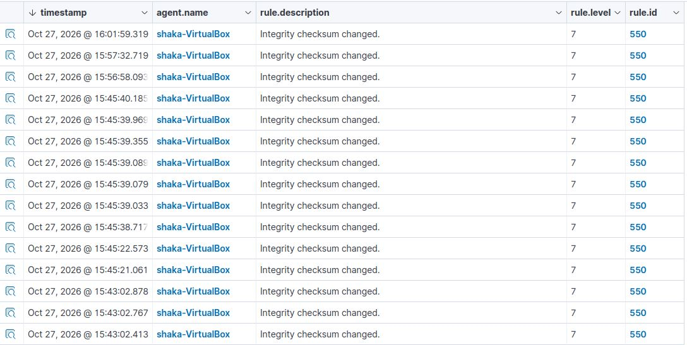

# Fase 04: DLP y Proteccion de Datos

## 1. Configuracion del Monitoreo
Se configuro el modulo FIM (File Integrity Monitoring) en el agente Linux Mint para vigilar el directorio `/home/shaka`. Se habilito la opcion `report_changes="yes"` para capturar el contenido modificado.
   

## 2. Simulacion de Fuga
Se creo un archivo llamado `tarjeta_credito.txt` con datos sensibles falsos. Posteriormente, se modifico el archivo para simular una alteracion de los datos.
   

## 3. Deteccion en Wazuh
Wazuh detecto el cambio de integridad y disparo la alerta:
* **Regla:** 550 (Integrity checksum changed)
* **Nivel:** 7.
* **Dato capturado:** El campo `syscheck.diff` registro el numero de tarjeta, demostrando la capacidad del SIEM para identificar datos sensibles en el sistema.
   

* **Evidencia:**

