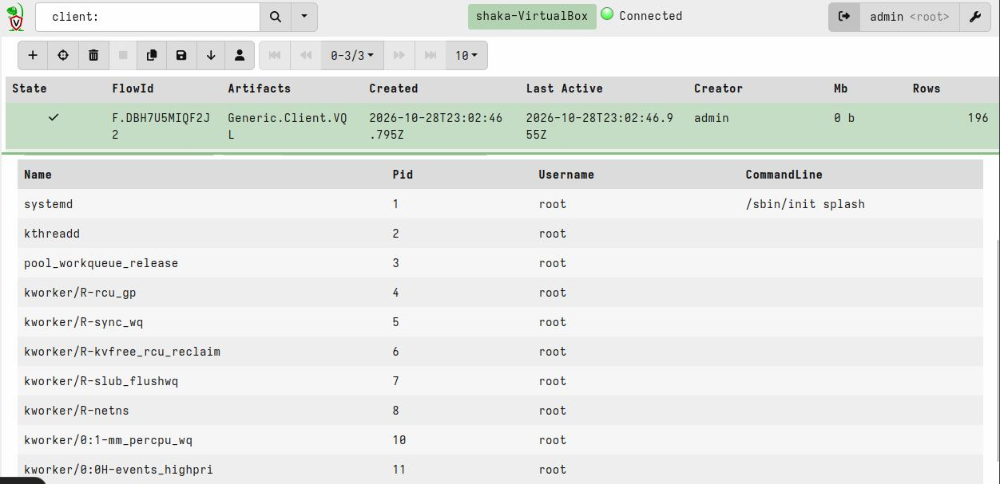

# Fase 05: Gestion de Endpoints y Salud de Controles

## 1. Evaluacion de Velociraptor (DFIR)
Se desplego un servidor de Velociraptor en Docker y se instalo su agente en el endpoint Linux Mint para realizar pruebas reales de recoleccion forense.
  

## 2. Prueba de Concepto (PoC) - Consulta VQL Real
Se conecto exitosamente el agente `shaka-VirtualBox` al servidor. Utilizando la interfaz de "VQL Drilldown", se ejecuto la siguiente consulta para extraer la lista de procesos en vivo:
 
`SELECT Name, Pid, Username, CommandLine FROM pslist()`
 

**Resultados:** Se obtuvieron 196 filas con informacion detallada de los procesos del endpoint, validando la capacidad de Velociraptor para el triage y analisis forense en tiempo real.
   

**Evidencia:**

