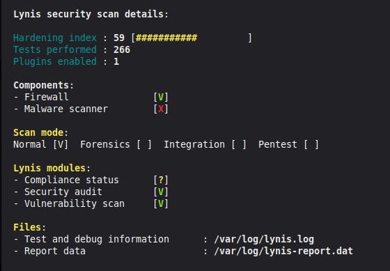
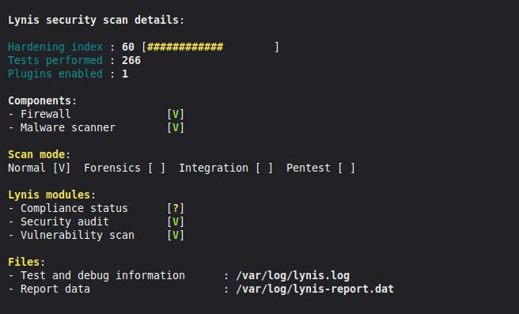

# Fase 06: Linea base de Seguridad

## 1. Evaluacion de Cumplimiento
Se intento utilizar OpenSCAP con el perfil CIS para Ubuntu 22.04, sin embargo, la version del escaner disponible en los repositorios (1.2.17) es incompatible con las reglas CIS (que requieren la version 1.3.x), generando un reporte vacio de 0% evaluacion.
<br><br><br>

## 2. Alternativa: Lynis
Como alternativa valida y compatible, se utilizo **Lynis**, una herramienta de auditoria de seguridad de codigo abierto.

**Comando ejecutado en Linux Mint:**
```bash
  sudo lynis audit system
```



<br><br><br>

## 3. Remediacion Aplicada
Se procedio a instalar **ClamAV** (antivirus open source) para cubrir el control faltante.

**Comandos ejecutados**
```bash
  sudo apt install -y clamav
  sudo systemctl stop clamav-freshclam
  sudo freshclam
  sudo systemctl start clamav-freshclam
```
<br><br><br>

## 4. Verificacion Post Remediacion
Se ejecuto nuevamente Lynis para validar la correccion. El control Malware scanner ahora aparece como [V] mejorando el indice de endurecimiento.



<br><br><br>
