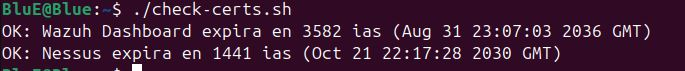

# Fase 07: Certificados SSL/TLS

## 1. Inventario
Se creo un inventario con los servicios HTTPS del laboratorio:
  - Wazuh Dashboard: `https://192.168.18.24:443`
  - Nessus: `https://192.168.18.24:8834`
   

## 2. Script de Comprobacion
Se desarrollo un script en Bash (`scripts/check-certs.sh`) que utiliza `openssl` para conectarse a cada servicio, extraer la fecha de expiracion y calcular los dias restantes. El script clasifica el estado OK, WARNING (menos de 30 dias) o CRITICAL (menos de 7 dias).
   

## 3. Resultados
- **Wazuh Dashboard:** expira en 3582 dias (2036).
- **Nessus:** expira en 1441 dias (2030).
   

**Evidencia:**

