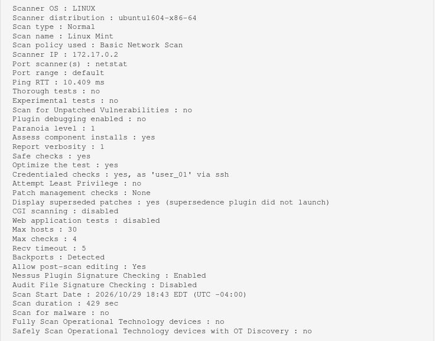

# Instalacion de Nessus Essentials en Docker

## 1. Despliegue
Se utilizo la imagen oficial de Tenable en Docker:
`docker run -d --name nessus -p 8834:8834 tenable/nessus:latest-ubuntu`
<br><br><br>

## 2. Registro
Se accedio a `https://localhost:8834` y se selecciono la opcion "Register for Nessus Essentials".
<br><br><br>

## 3. Escaneo
Se configuro un "Basic Network Scan" apuntando a la IP de la maquina Linux Mint para evaluar vulnerabilidades.
<br><br><br>

## 4. Escaneo Autenticado
Para realizar una evaluacion interna real, se preparo en el endpoint Linux Mint creando un usuario con permisos de escalada y se configuraron las credenciales SSH en Nessus.

**Comandos ejecutadoe en el L. Mint:**
```bash
sudo useradd -m -s /bin/bash user_01
sudo usermod -aG sudo user_01
echo "user_01 ALL=(ALL) NOPASSWD: ALL" | sudo tee /etc/sudoers.d/user_01
```


